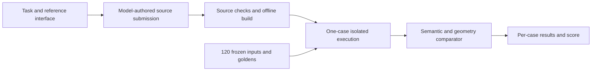

# ProgramBench DOT layout reconstruction demo

A source-reconstruction task and evaluation harness for rebuilding the behavior of Graphviz's `dot -Tplain` and `dot -Tplain-ext`.

I developed this as an application/demo project. The work shown here is task design, fixture generation, a semantic and geometry-aware comparator, isolated grading, adversarial checks, and analysis of recorded model attempts. It is not a production client deployment or a full LLM training pipeline. This is an independent demo inspired by ProgramBench, not an official ProgramBench release or endorsement.

## Start with the engineering

- [Comparator](evaluator/plain.py): validates complete graph, node and edge records, finite numbers, geometry and parallel-edge matching.
- [Runner](evaluator/run.py): scores one case per container with no network, a read-only filesystem, resource limits and a separate user.
- [Source boundary](author/validate_submission.py): checks source-only submissions, rebuilds them, and looks for reference-binary carryover. These are heuristic checks, not a proof against every attack.
- [Coverage](docs/coverage.md) and [threat model](docs/threat-model.md): requirements, failure cases and isolation assumptions.
- [Tests](evaluator/tests) and [recorded calibration](validation/README.md): inspect what is checked and what remains unverified.



## What the benchmark measures

The corpus contains 120 cases across 12 graph families, with 84 stdin cases and 36 file-input cases. Each case has one vote. A successful process exit and a complete matching plain-format result are both required. Record order and harmless whitespace are ignored; omitted fields, non-finite values, incorrect geometry and incorrect edge splines fail. Numeric tolerance is bounded by the [scoring contract](agent/docs/scoring.md).

**The corpus and goldens in this public demo are public.** They were held out from the original calibration attempts. They must not be described as hidden or used to claim contamination-free evaluation of future models. The original task instructions and threat model describe the calibration setup; publication changes the secrecy assumption, not the scoring function.

## Recorded results, not newly generated attempts

Eight saved model attempts passed between 14 and 44 cases out of 120. The arithmetic mean is 24.0625%. Four attempts used `gpt-6.1-sol` at high effort and four used `gpt-5.6-terra` at xhigh effort. These labels identify the recorded runs; they are not a model recommendation or a general ranking.

The six-hour setting was a ceiling, not a claim that every run lasted six hours. Candidate implementations were model-generated attempts. My contribution was the task and evaluation system. This public export includes per-case score records, not raw model transcripts or candidate source trees. [Validation notes](validation/README.md) separate recorded observations from checks rerun for this release.

## Quick local inspection

Use Python 3.10 or newer for the full tool/test workflow. The dependency-free unit suite can run without Docker:

```sh
python3 -m unittest discover -v
python3 -c 'from evaluator.run import load_cases; print(len(load_cases()), "verified cases")'
```

Docker-specific tests are skipped unless their environment variables are supplied. A passing source-only suite does not establish container isolation or replayed model scores.

## Build the reference locally

No prebuilt reference executable, third-party source archive, or Docker image is distributed in this repository. Acquire the exact upstream source and verify it before building. The Docker build uses the original pinned Linux/amd64 GCC image; on Apple Silicon this uses emulation and can be slow. Downloading images and building uses local disk and compute.

```sh
mkdir -p author/source author/reference agent/reference
curl --fail --location --output author/source/graphviz-14.0.4.tar.gz \
  https://gitlab.com/api/v4/projects/4207231/packages/generic/graphviz-releases/14.0.4/graphviz-14.0.4.tar.gz
python3 -c 'import hashlib,pathlib; p=pathlib.Path("author/source/graphviz-14.0.4.tar.gz"); assert hashlib.sha256(p.read_bytes()).hexdigest()=="ddac5f15ad1b2ad6d715cc64d6d0e6a366310c09c2c3a11284dafd1630e353b6"'
docker build --platform linux/amd64 --progress=plain \
  -f author/Dockerfile.reference --output type=local,dest=author/reference author/source
cp author/reference/dot agent/reference/dot
# Preserve the notices from the actual pinned source, not the current website.
tar -xOf author/source/graphviz-14.0.4.tar.gz graphviz-14.0.4/COPYING > agent/docs/LICENSE.upstream
tar -xOf author/source/graphviz-14.0.4.tar.gz graphviz-14.0.4/AUTHORS > agent/docs/AUTHORS.upstream
python3 -c 'import hashlib,pathlib; assert hashlib.sha256(pathlib.Path("agent/reference/dot").read_bytes()).hexdigest()=="2ba4c30c40f0238d40efe1d931a15e05858c561e1655f3bfa522b64f00341a25"'
docker build --platform linux/amd64 -t dot-plain-reconstruction:agent agent
```

If the executable hash differs, stop and inspect the toolchain/build rather than silently accepting a different oracle. See [third-party materials](THIRD_PARTY.md) before redistributing locally built binaries. The ignored build products are not automatically cleared for redistribution.

## Grade a source submission

After preparing the reference locally, submit a directory containing source plus `compile.sh`:

```sh
DOCKER_DEFAULT_PLATFORM=linux/amd64 python3 -m author.grade_submission \
  /path/to/submission --image dot-plain-reconstruction:candidate --output result.json
```

The grader performs an offline clean rebuild, audits built assets and starts a fresh restricted container for each case. A source/compile failure scores zero. Docker infrastructure failures are reported separately. Do not run untrusted submissions on a production Docker host; inspect the [threat model](docs/threat-model.md).

## Known limits

- The original candidate digest sorts native paths. Historical Windows and POSIX digests can differ for identical mixed-case filenames. Recorded hashes are retained as historical identifiers, not silently rewritten.
- The public runner has a small file-writing compatibility change that preserves explicit LF bytes. The comparator, corpus, tolerances and score aggregation are unchanged. Its evaluator digest therefore differs from the historical one.
- The original raw logs were not strict JSONL. They are omitted, together with session identifiers, timestamps and token telemetry. The public records use an explicit field allowlist.
- Eight attempts on one fixed corpus demonstrate a calibration exercise, not broad benchmark validity, current model capability or difficulty guarantees.
- Release-time replay coverage and remaining limitations are stated in [validation notes](validation/README.md). No new paid model attempts were run for this release.

## Provenance

The frozen source release and reference hashes are listed in [reference provenance](reference-provenance.json). The public snapshot has fresh history and excludes private contact metadata. [Sanitization notes](SANITIZATION.md) explain what was preserved, derived or omitted. Original authorship of the application demo is mine; upstream Graphviz and its dependencies remain their authors' work.
